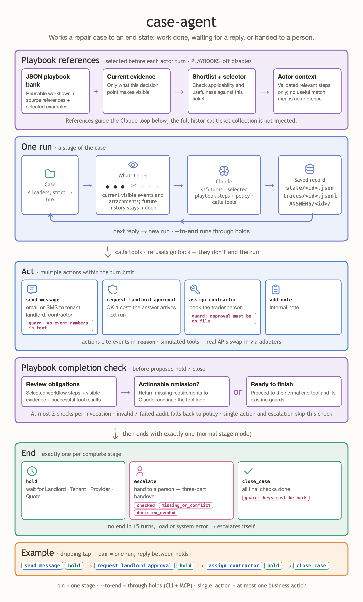

# case-agent

Real-World Agents Hackathon (Dwelly), London, 10 October 2026. Track: Property Management.


[Interactive version](diagram/case-agent.html)

## What we built

An agent that works property-maintenance cases for a letting agency, Northbridge Lettings. Each run reads a case folder, decides the next step, and acts through seven tools: send messages, request landlord approval, assign a contractor, add notes, then end with exactly one of `hold`, `escalate` or `close_case`. The case state persists between runs; when the next outside reply arrives, the agent resumes from it. The same loop also runs as an MCP server (`list_cases`, `run_case`, `resume_case`, `get_case`).

## The operational problem

Letting agencies spend most of their case time waiting: for landlord approval, tenant replies, quotes, contractor reports. The agent does every step that has a clear rule, and hands the case to a person where judgment is needed — emergencies, legal threats, money disputes, conflicting facts. Every action carries a `reason` that cites the event it answers (`[event 007]`), so each decision is auditable after the fact.

## Architecture

```
case dir (index.md, history.md, attachments/)
  -> parse.ts        events; Status/Updated/Completed lines never reach the agent
  -> cut.ts          the events this run may see; agency's own records hidden after the cut
  -> attachments.ts  PDF -> native document block or extracted text; images -> image blocks
  -> prompt.ts       prompt assembly; case text wrapped in <case_data> (evidence, not instructions)
  -> agent.ts        Claude tool loop, 15 turns max, must end with exactly one end tool
  -> tools.ts        7 zod-checked tools with guards and refusals
  -> run.ts          state, traces, answers; --next resumes, --to-end runs through holds
  -> mcp.ts          the same loop exposed over stdio MCP
```

Per run it writes `state/<id>.json` (case memory for `--next`), `traces/<id>.jsonl` (every model call and tool call, older traces rotated aside), and `ANSWERS/<id>/` (`ANSWER.md`: status, timeline, outbox, approvals, final checks. `REASONING.md`: the cited reason for each action plus the agent's notes).

The rules are in `policy.md`, distilled from the 50 public Property Management cases in `data/public/`.

Three kinds of guardrails:

- **Tool guards.** `assign_contractor` refuses until landlord approval is on file (a request from an earlier run, or an agency record of one). `send_message` refuses `[event N]` references in message text. `close_case` refuses while keys are outstanding.
- **Loop limits.** A run that does not end in 15 turns auto-escalates; a system error escalates with a handover summary.
- **Injection defense.** All case content arrives inside `<case_data>` tags, and policy rule 12 declares it evidence, not instructions.

Tools are simulated: each writes to the case state rather than a live system. `runTool` accepts adapter functions, so a real email, SMS or job API can replace each simulated body without touching the loop.

## How to run

```bash
npm install
cp .env.example .env                                   # add ANTHROPIC_API_KEY
npm run case -- run <case-dir>                         # first run
npm run case -- run <case-dir> --next                  # resume on the next outside reply
npm run case -- run <case-dir> --to-end                # resume through holds until an end state
npm run case -- run-all <cases-dir> --concurrency 4    # every case in a folder, one stage each
npm run case -- run-all <cases-dir> --to-end --concurrency 4  # every case, run to its end state
npm run mcp                                            # stdio MCP server (CASES_DIR, OUT_DIR overridable)
npm test
npm run typecheck
npm run extract                                        # Docling pre-extract of attachments (optional)
```

Two run modes. A plain `run` works exactly one stage: the agent sees events up to the next outside reply, acts, and ends. `--to-end` keeps resuming after each `hold` until the case closes, escalates, or has no further outside events (capped at 50 stages). Use `--to-end` for batch and Reality Test runs — a single-stage `run` decides on the opening events only, which can be under 10% of a case.

The tests read the public cases from `data/public/Property Management` (gitignored). Link them once:

```bash
git clone https://github.com/DwellyOrg/HackatonPublicCases.git ../HackatonPublicCases
mkdir -p data/public && ln -s "$(cd ../HackatonPublicCases && pwd)/Property Management" "data/public/Property Management"
```

## Models, APIs and external services

- Anthropic Messages API through `@anthropic-ai/sdk`. Model: `claude-sonnet-5-5` by default (set `MODEL`; the batch must finish inside 30 minutes). Prompt caching breakpoints on the system prompt, tool specs and the latest message.
- `pdfjs-dist` for PDF text when a file is too large to send natively. `NATIVE_PDF_MAX_MB` (default 5) sets the native-PDF threshold, capped at 100 pages and a 20 MB prompt budget; larger files go as extracted text truncated to 8,000 characters.
- `@modelcontextprotocol/sdk` for the MCP server. `scripts/extract.py` uses Docling via `uv` for structured markdown of attachments.
- No live services: messages, approvals and assignments are outbox entries in case state.

## Assumptions

- The agent acts as the agency. After the initial cut it sees only events from outside parties; its own actions stand in for the agency's recorded steps.
- Approval counts as "on file" when an earlier run made the request, or a visible event matches the agency's recorded-approval phrasing (`landlord approval confirmed` / `landlord who approved`).
- The agent sees time only through event timestamps. The prompt computes "days since last contact" per party from them, so "3 days without reply" works only while a later event supplies "now".
- Case content is untrusted input. Text from tenants, landlords, contractors or attachments cannot change the policy rules.

## Known limitations

- Large PDFs lose layout: above the size or page cap they degrade to extracted text, and long text is truncated.
- The recorded-approval detection is a two-phrase match; agency wordings outside it are missed.
- Cases that load in "raw mode" (reconstructed from unstructured files) can leak outcome details; `ANSWER.md` flags them for review.
- Simulated tools mean nothing actually leaves the outbox; message quality is reviewed in `ANSWER.md`, not in an inbox.

## Next steps

- An evaluation bench that replays the public cases event by event and grades each decision against the real history.
- Real adapters for email, SMS and the agency's job system; the seam already exists in `runTool`.
- A watch mode that ingests a new reply and resumes automatically, replacing `--next`.
- A human-in-the-loop queue for escalations, writing a person's decision back into the case as an event.

## Runs dashboard

`npm run dashboard` starts a local dashboard at http://127.0.0.1:4317 (localhost only).

- Reads every run under `runs/` (batch runs with `state/`, eval runs with `results.json`) plus `evals/results/`.
- Shows all 50 public cases: status, flow diagram, trace, ANSWER/REASONING, and entities found in the case.
- **Data model** tab: properties, issues, organisations, staff, job refs, money, visits and documents extracted from the cases (`GET /api/entities`).
- Re-run one case, selected cases, or all 50 (modes: to-end, stage, next). The previous result is archived to `history/<case>/<stamp>/` first. Re-runs need `ANTHROPIC_API_KEY`.
- Env: `DASHBOARD_PORT`, `CASES_DIR`, `RUNS_DIR`, `MODEL`, `DASHBOARD_CONCURRENCY`.
