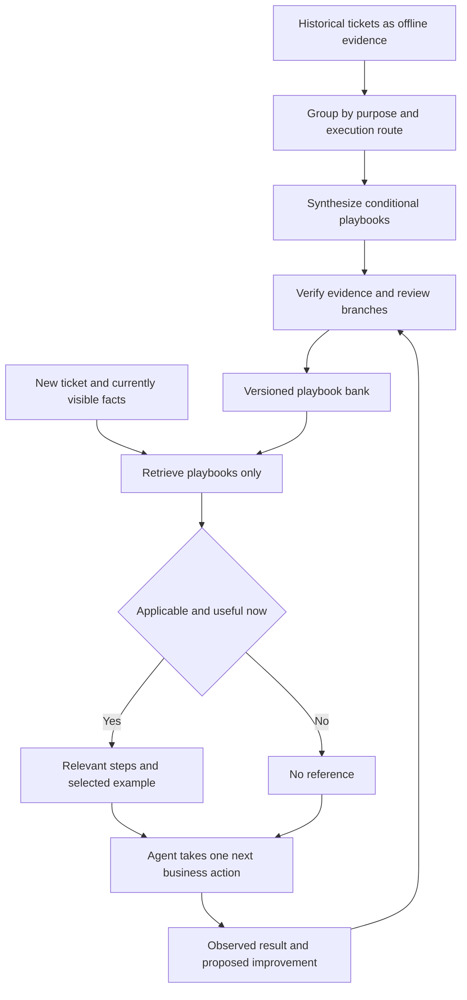

# Property Management Playbook Bank Plan

Build a small bank of reusable property-management playbooks. Historical tickets are offline evidence for synthesis; only playbooks are searchable and supplied to the agent. New experience updates a playbook rather than creating one searchable record per ticket.

The initial corpus contains 50 synthetic public cases and 1,505 events. Manual grouping by execution route and purpose yields eight scenario playbooks, plus four reusable decision modules. Structured definitions are in `../playbooks/property-management-playbooks.json`; assignments and counts are in `../playbooks/clustering-audit.json`.

## Knowledge scope

The bank has twelve playbooks reviewed for reference use. Each scenario has conditional steps and can compose decision modules. Schema version 2 adds explicit decision checks, communication requirements, expected events and possible next steps. Bank version 4 additionally makes quote clarification precede approval and routes missing ownership consent to the decision owner.

| ID | Scenario | Primary cases |
| --- | --- | ---: |
| PB01 | Supported tenant checks and confirmed resolution | 4 |
| PB02 | Landlord managed repair | 5 |
| PB03 | Agency arranged assessment and repair | 25 |
| PB04 | Checkout cleaning and coordinated works | 6 |
| PB05 | Garden scope responsibility and completion evidence | 4 |
| PB06 | Warranty and remedial repair | 2 |
| PB07 | Tenant supplied replacement and property ownership | 2 |
| PB08 | Reading requests and inspection reports | 2 |

The four decision modules are PB09 scope, quote and approval boundaries; PB10 booking, access and disrupted attendance; PB11 material identity and evidence conflicts; and PB12 completion evidence, keys, invoices and remaining work. Their selected source memberships overlap the scenario clusters and do not add cases to the total.

Each playbook retains at most two short representative examples. Original files, case and event IDs, revision and hashes provide audit evidence. Original tickets, event bodies and attachment chunks do not enter the searchable bank. The offline clustering audit contains case assignments and hashes without ticket text and is excluded from agent retrieval.

All definitions now have reference_reviewed status and reference_only execution status. Engineering review does not certify historical decisions or authorize actions. Current operational policy and existing tool guards remain authoritative. The review findings are in `../playbooks/review.json`.

## Architecture

## Playbook definition

Each version contains a stable ID, title, trigger, exclusions, conditional steps, current-fact prerequisites, missing-information handling, compatible tool names, completion conditions, selected examples, evidence pointers, review status and source revision. A source example cannot supply current approval, consent, payment, identity, equipment layout or completion.

The structured candidate definitions map proposed actions to the existing tools: `send_message`, `request_landlord_approval`, `assign_contractor`, `add_note`, `hold`, `escalate` and `close_case`. They are knowledge artifacts; they do not implement a new execution engine. The current tools record simulated actions and do not physically repair equipment, inspect unavailable files, make payments or book an external calendar.

A playbook can return to a prior stage, wait, require clarification or hand over to a person. Unsupported branches remain unknown. Do not force every ticket through a complete workflow or create a technical repair tree from sparse provider summaries.

## Storage

Retain PostgreSQL with optional pgvector as the planned database. Start from the twelve versioned JSON definitions so the content and retrieval contract can be reviewed before database setup. Structured filtering and text search should be measured first; vector search is optional at this size. If enabled, index playbook content only.

The database contains `playbooks`, `playbook_versions`, `playbook_evidence`, optional `playbook_embeddings`, `playbook_change_proposals` and retrieval audit records. Evidence rows hold source pointers, hashes and brief findings, not complete case histories. There are no searchable `source_cases`, `source_events` or per-ticket `solutions` tables.

Searchable sections, if needed, are sections of a particular playbook version and resolve back to that version. They must not become disguised ticket records. Original source files remain in the source repository and are accessed only during offline review.

## Initial synthesis and review

1. Preserve the source revision and assign every case to one primary scenario. Record mixed ownership and contradictory evidence.
2. Generalize the recurring steps across cases. Distinguish recorded behavior, observed outcome and a proposed corrective guard.
3. Link each branch to precise evidence. Verify file hashes, cited events and source claims in code; presence of an event ID alone does not validate a claim.
4. Review permission boundaries, missing-information behavior and completion requirements against current operational rules.
5. Keep at most two examples illustrating distinct branches or a useful counterexample. Generalize names, addresses, contacts and amounts.
6. Publish a reviewed version and rebuild only that playbook's search representation. Disputed or retired versions are excluded from retrieval.

The initial semantic grouping is manual, with deterministic counts. It is not an embedding clustering run or an agent-quality evaluation. The repository includes all 50 primary assignments so the taxonomy can be challenged and revised.

## Retrieval and context

Build a query from the current ticket's purpose, issue, stage, known permissions, active owner, constraints and material unknowns. Retrieve candidate playbooks, assess relevance and usefulness, and supply only steps that help the present decision. A scenario and a relevant decision module may be combined. Do not concatenate all twelve playbooks.

An unknown prerequisite can make a clarification step useful, but it cannot authorize the dependent action. Preserve unknown facts as unknown in code. Keep playbook guidance in a separate typed context section; prohibit it from populating current-ticket fields. Rejected candidates, unreviewed definitions and offline audit records do not enter the context. Source references, provenance, cluster membership and representative examples are stripped by the runtime schema before retrieval. No useful match returns an empty reference set.

Preserve existing `run_case` and `resume_case` behavior: each invocation advances at most one business action. Retrieval selects guidance and does not execute or approve the action. A search or assessment failure leaves normal ticket processing available.

## Updating knowledge

New handling and feedback can propose a revised trigger, branch, prerequisite, failure condition or example. Repeated instances strengthen the evidence for the same playbook rather than creating new searchable records. Add a distinct playbook only when the execution route or decision conditions differ materially.

Review proposals before activating a new version. Keep contradictory evidence and failed outcomes visible to reviewers; do not overwrite a branch because the latest ticket says Completed. If an example is replaced, preserve its evidence pointer in version history while keeping the active example set small. Runtime feedback never automatically appends full tickets to the retrieval corpus.

## Evaluation

Compare the agent without playbooks against the agent with filtered playbook guidance, using the same decision-point inputs and a fixed independent judge. Measure next-action correctness, prerequisite handling, inappropriate references, conflict handling, premature closure, latency and empty-reference behavior.

Hold out entire cases and all their counterfactual variants before synthesis. Rebuild affected playbooks without the held-out evidence; removing a displayed example alone does not remove learned branches. If rebuilding is unavailable, exclude the affected version entirely. Freeze playbook, model and assessment versions for each run.

Include regression cases for a failed simple check, limited approval, landlord ownership, changed quotes, conflicting identities, a missed visit, promised but unreturned keys, missing invoices, unrelated tickets and retrieval failure. Existing eval and judge work remains stashed; this plan does not claim a live judge run or performance improvement.

## Implementation sequence

First review the twelve candidate definitions and evidence, then implement typed playbook contracts and code validation. Add database storage if needed, implement retrieval of playbooks only, add the relevance and usefulness assessor, and connect the context hook. Implement reviewed feedback updates after the initial bank can be evaluated.

The current implementation adds `src/playbooks.ts` to the existing loop. Every model turn shortlists at most four workflows, assesses helpfulness against current text and policy, and supplies at most two workflows with two steps each. Selection requires valid IDs and visible current-evidence IDs; failures fall back to ordinary handling. CLI and MCP use the same integration, with `PLAYBOOKS=off` for baseline runs. A paired eight-ticket, two-trial development evaluation uses Haiku and a fixed blind process judge. Full transcripts and examples never enter retrieval; database storage, embeddings and operational approval remain future work.
